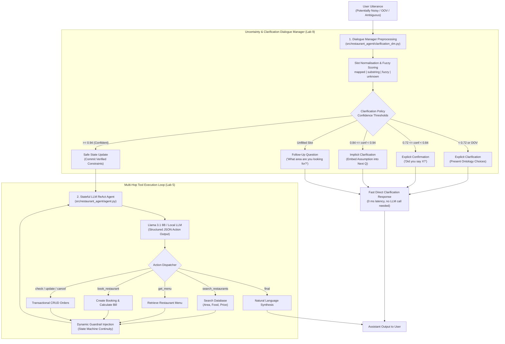

# Uncertainty-Aware Task-Oriented LLM Restaurant Dialogue Agent

[](https://github.com/Ceviche98/llm-restaurant-dialogue-agent/actions/workflows/ci.yml)
[](https://www.python.org/downloads/)
[](https://github.com/Ceviche98/llm-restaurant-dialogue-agent)
[-success.svg)](https://github.com/Ceviche98/llm-restaurant-dialogue-agent)
[](https://github.com/Ceviche98/llm-restaurant-dialogue-agent)
[](LICENSE)

A production-grade, uncertainty-aware task-oriented conversational AI system combining **LLM multi-hop tool execution** (Coursework 1 / Lab 5) with a **Dialogue Manager (DM) for slot normalisation, confidence thresholding, and clarification policies** (Assignment 2 / Lab 9), developed for the **MSc Artificial Intelligence** curriculum at **Queen Mary University of London (QMUL)**.

The system handles real-world conversational uncertainty, acoustic transcription noise (ASR errors), out-of-vocabulary (OOV) inputs, off-topic drift, and transactional restaurant booking lifecycles.

---

## System Architecture



---

## 1. Historical Foundation: Finite State Automata (FSA)

As a baseline foundation in Coursework 1 (Part A), task-based conversational flows were originally explored using deterministic **Finite State Automata (FSA)** and Google Dialogflow CX. 

While finite state systems guarantee predictable state transitions and strict business rule compliance, they suffer from brittleness: unexpected user inputs, out-of-order slot filling, and phrasing variations break the state machine. 

To overcome these constraints, this project transitions from rigid finite-state control to a **hybrid neuro-symbolic architecture**: a statistical **Dialogue Manager** that governs confidence thresholds and slot grounding, paired with an **instruction-tuned Large Language Model** that drives flexible multi-hop conversation and tool invocation.

---

## 2. Dialogue Manager & Clarification Policies (Lab 9)

In spontaneous conversation or spoken dialogue environments (where Whisper or Vosk ASR outputs contain acoustic transcription noise), user utterances frequently contain imprecise, misspelled, or out-of-vocabulary slot values.

<div align="center">
  
  <p><em>Figure 1: (Left) Uncertainty-aware clarification policy decision spectrum. (Right) Automated scenario benchmark results.</em></p>
</div>

### A. Slot Normalisation (`normalize_slot_verbose`)
Every input utterance is evaluated against the domain ontology (`area`, `food`, `pricerange`) across a 5-tier classification hierarchy:
1. **Mapped ($1.00$ Confidence):** Exact match with an ontology entry or known synonym (e.g., *"downtown"* $\to$ `"centre"`).
2. **Substring ($0.95$ Confidence):** An ontology keyword appears as an exact whole-word substring in the text.
3. **Fuzzy Match ($0.72 - 0.94$ Confidence):** Token-level $n$-gram Levenshtein / SequenceMatcher scoring against ontology keys (e.g., noisy ASR transcription *"lo priced"* $\to$ `"cheap"` or *"japnese"* $\to$ `"japanese"`).
4. **Unknown ($0.00$ Confidence):** A concept was mentioned by the user (detected via domain keyword hints), but cannot be grounded to the ontology (e.g., *"greek food"*).
5. **Missing ($0.00$ Confidence):** Slot was not mentioned in the utterance.

### B. Decision Policy & Clarification Strategies (`decide_clarification`)
Based on the confidence scores and slot status, the Dialogue Manager selects the optimal communicative action:

| Input Condition | Policy Action | Agent Clarification Response |
| :--- | :--- | :--- |
| **Mentioned, but Out-of-Vocabulary** | `explicit_clarification` (with options) | *"I didn't quite catch the food. You can choose between: chinese, italian, indian, japanese, vegetarian, or british."* |
| **Fuzzy Match with Low Confidence ($< 0.84$)** | `explicit_clarification` (yes/no confirmation) | *"I think you said japanese. Is that right?"* |
| **Fuzzy Match with Medium Confidence ($0.84 - 0.94$)** | `implicit_clarification` (carry forward) | *"Looking for cheap pricerange. What area are you looking for?"* |
| **Unspecified Essential Slot** | `follow_up` (slot filling) | *"What area are you looking for?"* |
| **High Confidence ($\ge 0.94$)** | Direct State Commit | Passes grounded state directly to LLM tool execution loop without interruption. |

### C. Safe State Updates (`update_state_from_parsed`)
The Dialogue Manager guarantees state safety:
- High-confidence mapped values are committed immediately.
- Confirmed slot values are **never overwritten** by subsequent noisy or unknown tokens.
- Unconfirmed hypotheses are held in pending status until the user confirms them.

---

## 3. LLM Multi-Hop Reasoning & Tool Execution (Lab 5)

When input is confident and disambiguated, the **Stateful LLM ReAct Agent** orchestrates multi-turn task completion using deterministic JSON actions.

### Tool Protocol
The agent communicates via strict JSON actions:
- `search_restaurants(area, food, pricerange)`: Queries the relational database.
- `get_menu(restaurant_id)`: Fetches dishes, descriptions, prices, and allergen details.
- `book_restaurant(restaurant_id, day, time, people, customer_name, dishes)`: Confirms booking, pre-orders dishes, and generates unique order IDs (`ORD-XXXXXX`).
- `check_order(order_id)`: Retrieves real-time booking and order status.
- `update_order(order_id, dishes)`: Modifies pre-ordered dishes and recalculates total price.
- `cancel_order(order_id)`: Non-destructively marks the booking as cancelled.
- `final(response)`: Returns conversational natural language output to the user.

### Dynamic Guardrails & State Machine Control
To prevent infinite loops or premature booking:
1. **Search Disambiguation Guardrail:** After `search_restaurants` returns candidates, the agent is restricted to `action=final` to present the options and solicit user selection before booking.
2. **Zero-Result Recovery Guardrail:** When zero restaurants match constraints, the agent prompts the user to relax constraints rather than looping.
3. **Post-Booking Lock:** Once booked, the agent is blocked from calling `search_restaurants` again, preserving order state.
4. **Off-Topic Guidance (Phase 0):** Unrelated queries trigger a polite redirect that outlines system capabilities.

---

## 4. Multi-Turn Dialogue Transcripts

### Dialogue 1: Clarification under Noisy Input & Food Pre-Order
```
User:       "I want some lo priced japnese dining around central please"
DM Action:  Implicit Clarification (Fuzzy match on 'cheap' and 'japanese', mapped 'centre')
Agent:      "Looking for cheap pricerange. We have Sakura Japanese (r003) in the centre. Would you like to book?"

User:       "Yes, book for 2 people on Friday at 20:00 under Oscar, and pre-order 2 Chicken Teriyaki"
LLM Action: {"action": "book_restaurant", "args": {"restaurant_id": "r003", "day": "Friday", "time": "20:00", "people": 2, "customer_name": "Oscar", "dishes": {"j01": 2}}}
Agent:      "Your table at Sakura Japanese is confirmed for Friday at 20:00 for 2 guests under Oscar. Total: £25.00. Your order ID is ORD-466820."
```

### Dialogue 2: Out-of-Vocabulary Explicit Clarification
```
User:       "Can you find me a mexican restaurant in riverside?"
DM Action:  Explicit Clarification (Detected 'mexican' as OOV food)
Agent:      "I didn't quite catch the food. You can choose between: chinese, italian, indian, japanese, vegetarian, or british."

User:       "Okay, let's do Italian instead"
DM Action:  Direct Commit ('italian' mapped with confidence 1.0)
LLM Action: {"action": "search_restaurants", "args": {"area": "riverside", "food": "italian"}}
Agent:      "We found Bella Vista (r002) in riverside. Would you like to reserve a table?"
```

---

## 5. Quantitative Scenario Benchmark

The repository includes an automated evaluation harness (`scripts/evaluate_scenarios.py`) validating the system against all canonical coursework test scenarios:

| Scenario ID | Dialogue Objective | Turn Count | Key Verification Checks | Status |
| :--- | :--- | :---: | :--- | :---: |
| **T1** | Booking with Food Pre-Order & Conversation End | 6 | Order persistence verified, total price computed, clean exit | **PASS (100%)** |
| **T2** | Off-Topic Guidance & Recovery | 1 | Lists allowable areas/cuisines, politely redirects user | **PASS (100%)** |
| **T3** | Full CRUD Order Lifecycle | 11 | Create $\to$ Query $\to$ Update dishes $\to$ Cancel $\to$ Verify cancelled | **PASS (100%)** |
| **T4** | Invalid Order ID Recovery | 1 | Gracefully returns *"Order not found"* error without crashing | **PASS (100%)** |
| **Total** | **End-to-End Benchmark Suite** | **19** | **All 4 Scenarios Passed** | **100.0% PASS** |

---

## Repository Structure

```
llm-restaurant-dialogue-agent/
├── data/
│   ├── menus.json                  # Dishes, prices, and allergen details
│   ├── orders.json                 # Transactional booking records
│   ├── restaurants.json            # Restaurant profiles (area, food, price)
│   └── test_scenarios.json         # Automated evaluation multi-turn scenarios
├── docs/
│   └── assets/                     # Architecture diagrams and benchmark plots
├── scripts/
│   ├── evaluate_scenarios.py       # Automated benchmark evaluation harness
│   └── run_agent_cli.py            # Interactive terminal CLI chat
├── src/
│   └── restaurant_agent/
│       ├── __init__.py
│       ├── agent.py                # Stateful ReAct dialogue agent & LLM interface
│       ├── clarification_dm.py     # Slot normalisation & clarification policy (Lab 9)
│       ├── database.py             # Relational data layer & CRUD order management
│       ├── evaluator.py            # Scenario simulation runner & rule-based mock LLM
│       └── tools.py                # Tool dispatch handler & JSON schema validator
├── tests/
│   └── test_restaurant_agent.py    # 8 automated unit & integration tests
├── .gitignore
├── LICENSE                         # MIT License
├── pyproject.toml
└── requirements.txt
```

---

## Quickstart & Usage

### 1. Installation
```bash
git clone https://github.com/Ceviche98/llm-restaurant-dialogue-agent.git
cd llm-restaurant-dialogue-agent
pip install -r requirements.txt
pip install -e .
```

### 2. Run the Automated Scenario Benchmark
```bash
python scripts/evaluate_scenarios.py
```
Output:
```
========================================================================
SCENARIO EVALUATION SUMMARY: 4/4 Passed (100.0%)
========================================================================
[PASS] t1_booking_with_food_preorder (6 turns)
[PASS] t2_offtopic_guidance (1 turns)
[PASS] t3_query_update_cancel (11 turns)
[PASS] t4_nonexistent_order_id (1 turns)
```

### 3. Run the Unit & Integration Test Suite
```bash
pytest tests/ -v
```

### 4. Interactive Terminal Chat CLI
```bash
python scripts/run_agent_cli.py
```
*(Optional: Provide `--model` and `--ollama-url` to connect to a running local Ollama instance with Llama 3.1 8B)*.

---

## License

This project is licensed under the MIT License — see the [LICENSE](LICENSE) file for details.
