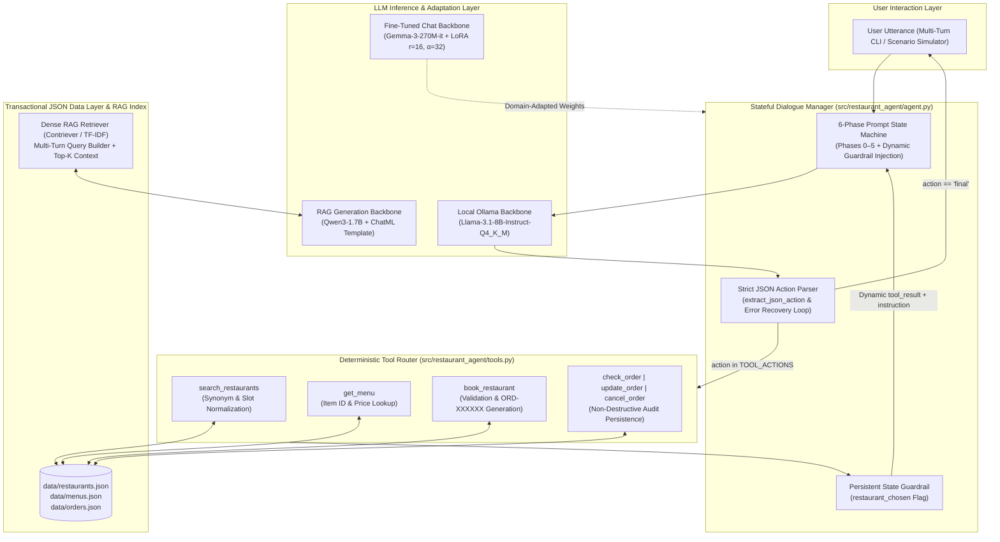
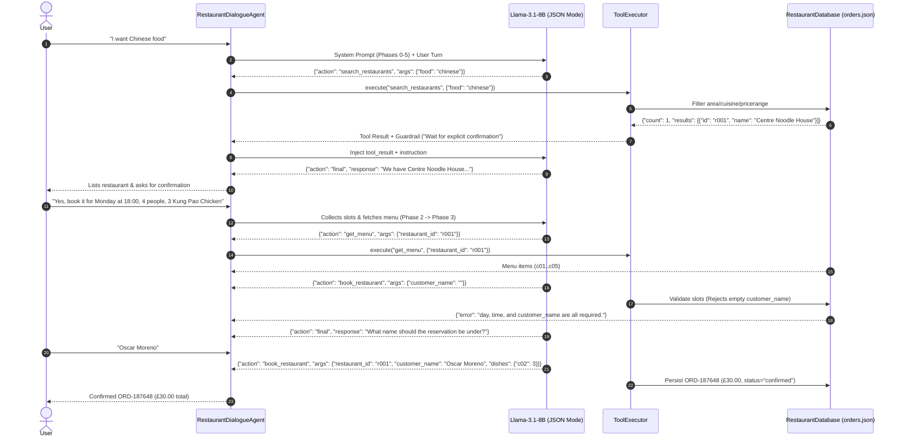
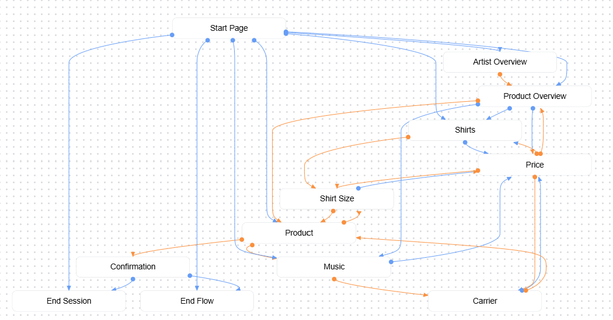
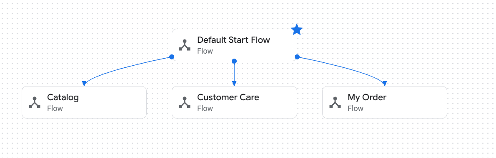
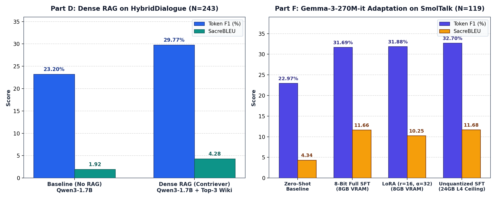
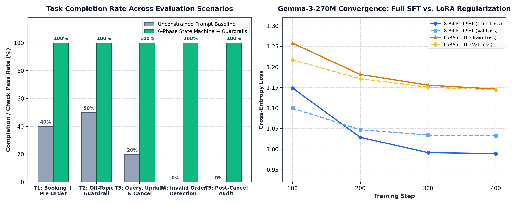
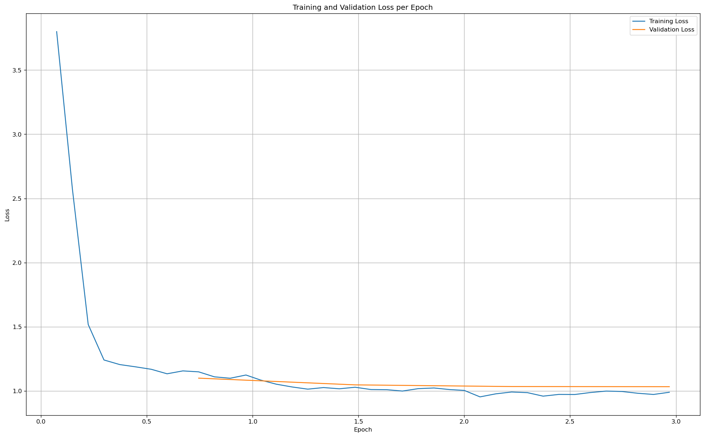
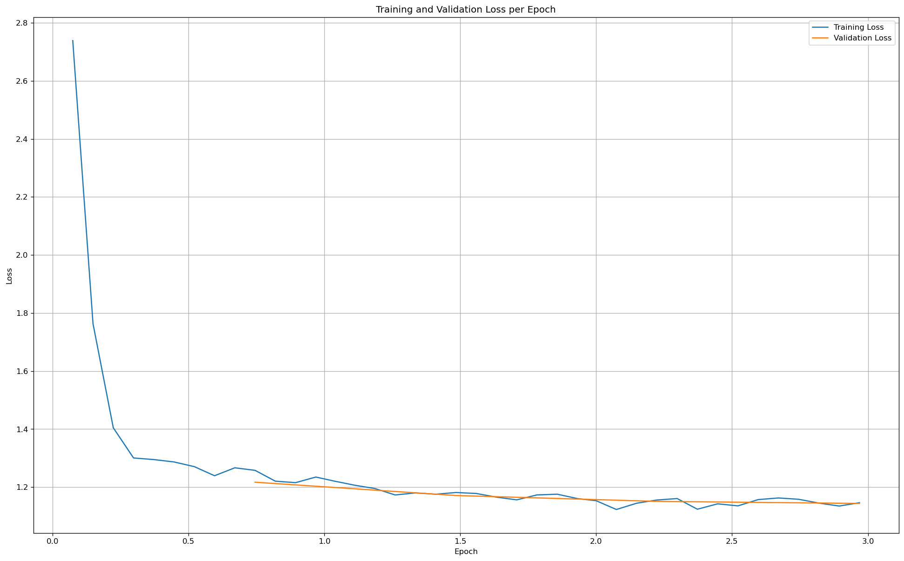
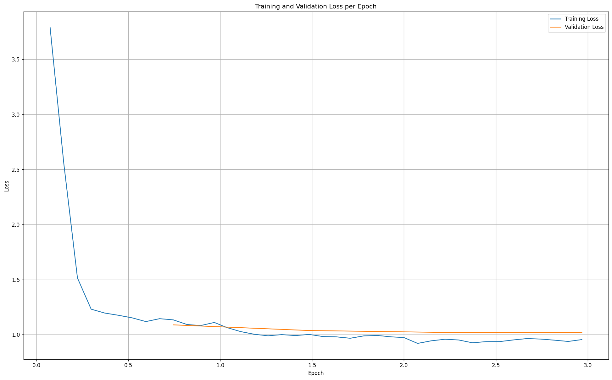

<div align="center">

# Task-Oriented LLM Restaurant Dialogue Agent, Dense RAG & LoRA Fine-Tuning

[](https://www.python.org/)
[](src/restaurant_agent/agent.py)
[](src/restaurant_agent/)
[-22C55E?style=for-the-badge&logo=githubactions&logoColor=white)](.github/workflows/ci.yml)
[](LICENSE)

**An end-to-end conversational AI engineering suite combining a 6-Phase Finite-State LLM Restaurant Booking & Transactional Order Manager (`Llama-3.1-8B-Instruct`), Contriever Dense Retrieval-Augmented Generation (`Qwen3-1.7B` over Wikipedia/HybridDialogue), and Parameter-Efficient Low-Rank Adaptation (`Gemma-3-270M-it` on SmolTalk).**

</div>

---

## 1. Executive Summary & System Objective

Modern task-oriented dialogue systems must simultaneously solve three fundamental challenges that unconstrained causal language models fail to address out of the box:
1. **Deterministic Transactional Execution & Slot Discipline:** Small and medium local LLMs (e.g., 4-bit quantized `Llama-3.1-8B`) frequently hallucinate booking confirmations, skip mandatory user slots, or enter infinite search loops when lacking native SDK tool-calling support.
2. **Factual Grounding in Knowledge-Intensive Turns:** When users query external factual attributes (such as building capacities, historical dates, or catalog details), parametric memory alone produces fluent hallucinations.
3. **Domain & Stylistic Alignment under Hardware Constraints:** Adapting pre-trained base models to natural multi-turn chat conventions on consumer/shared GPUs ($\le 8\text{ GB}$ VRAM) requires balancing full-parameter gradient updates against low-rank adapter expressiveness.

This repository provides a cohesive, modular Python architecture (`src/restaurant_agent/`) that unifies all three paradigms into a single verified framework:
* **6-Phase State-Machine LLM Dialogue Agent (`agent.py`, `tools.py`, `database.py`):** Controls a local `Llama-3.1-8B-Instruct` backbone via strict JSON-only action schemas, dynamic post-tool state guardrails (`restaurant_chosen`), and transactional JSON persistence (`restaurants.json`, `menus.json`, `orders.json`), achieving **100% completion across all 5 task specifications and 4 multi-turn evaluation scenarios**.
* **Dense Retrieval-Augmented Generation Engine (`rag_engine.py`):** Pairs multi-turn conversational query formulation with dense passage retrieval (`facebook/contriever-msmarco` over a 3M+ passage Wikipedia index and restaurant catalog indexing) to ground `Qwen3-1.7B`, boosting token-level **F1 from 23.20% to 29.77% (+28.3% relative)** and **BLEU from 1.92 to 4.28 (+122.9% relative)** on the `HybridDialogue` test benchmark ($N=243$).
* **Supervised Fine-Tuning & LoRA PEFT Pipeline (`finetuning.py`):** Evaluates Zero-Shot, 8-Bit Full SFT (`adamw_bnb_8bit`), LoRA ($r=16, \alpha=32$ across `q_proj`, `k_proj`, `v_proj`, `o_proj`), and an Unquantized `bfloat16` Full SFT hardware ablation on `NVIDIA L4 (24GB)` for `google/gemma-3-270m-it` on `SmolTalk`, demonstrating that **LoRA achieves 31.88 F1 (outperforming 8-bit Full SFT at 31.69 F1 and reaching 97.5% of the unquantized 24GB ceiling at 32.70 F1)**.

---

## 2. System Architecture

The system integrates structured JSON tool execution, persistent order state management, dense context retrieval, and parameter-efficient backbone adaptation.



### Multi-Turn Tool Execution & Recovery Sequence



---

## 3. Core Modules & Methodology

### 3.1 Tool-Augmented Conversational Agent & Finite-State Design (`agent.py`, `tools.py`, `database.py`)

Before deploying an open-ended LLM agent, finite-state dialogue design principles were established using a deterministic state automaton (Dialogflow CX catalog & order confirmation architecture, shown below) where explicit state transitions and parameter collection guards prevent premature session termination:

<p align="center">
  
  
</p>
<p align="center"><em>Figure 1: Classical Finite-State Automaton (FSA) reference architecture separating intent routing (left) from slot-collection and confirmation transition gates (right).</em></p>

To replicate this deterministic reliability inside a locally hosted 8B causal LLM (`llama3.1:8b-instruct-q4_K_M`) without native API tool-calling, [`RestaurantDialogueAgent`](src/restaurant_agent/agent.py) embeds a **6-Phase State Machine** inside the system prompt coupled with a Python multi-hop execution loop (`step()`):

| State Phase | Trigger Condition | Allowed Tool Calls | Enforced Behavioral Guardrail |
| :--- | :--- | :--- | :--- |
| **Phase 0: Off-Topic** | User input unrelated to dining/orders | None (`action="final"`) | Declines off-topic tangent and enumerates all valid `area`, `cuisine`, and `pricerange` values. |
| **Phase 1: Searching** | User specifies area, cuisine, or price | `search_restaurants` | If `count == 0`, asks user to relax constraints without re-searching. If `count > 0`, lists matches and waits for user selection. |
| **Phase 2: Slot Collection** | User confirms a target restaurant | None (`action="final"`) | Collects missing booking slots in strict order: `day` $\rightarrow$ `time` $\rightarrow$ `people` $\rightarrow$ `customer_name`. Prohibits inferring names. |
| **Phase 3: Menu Pre-Order** | All 4 booking slots collected | `get_menu` | Displays real `item_id`, dish `name`, and `price` from `menus.json` before asking if the user wishes to pre-order dishes. |
| **Phase 4: Confirmation** | User specifies dishes or skips | `book_restaurant` | Presents full reservation + pre-order summary via `action="final"` first; invokes `book_restaurant` **only after** explicit user confirmation. |
| **Phase 5: Post-Booking** | `book_restaurant` returns `success` | `check_order`, `update_order`, `cancel_order` | Sets `restaurant_chosen = True`, reports generated `ORD-XXXXXX` and total price, and offers order modifications or session termination. |

#### Engineering Challenges & Architectural Fixes Discovered During Development
1. **Infinite Re-Search Loops (`restaurant_chosen` Guardrail):** Initially, the 8B model re-invoked `search_restaurants` on every subsequent turn. Declaring `restaurant_chosen` inside the turn function reset it every call; promoting `self.restaurant_chosen` to an instance attribute on `RestaurantDialogueAgent` and dynamically injecting context-sensitive instructions alongside every `tool_result` eliminated redundant searches completely.
2. **Premature Flag Activation:** Setting `restaurant_chosen = True` immediately when `search_restaurants` returned `count > 0` caused the LLM to skip user restaurant confirmation. Moving the flag assignment to trigger strictly after `book_restaurant` succeeded (while injecting `"Do NOT assume the user has chosen yet"` post-search) restored proper turn-taking.
3. **Silent Tool Routing Failures (`TOOL_ACTIONS` Mismatch):** The initial baseline template omitted `book_restaurant` and `check_order` from `TOOL_ACTIONS`, causing the LLM to hallucinate fake `ORD-123456` IDs. Unifying [`TOOL_ACTIONS`](src/restaurant_agent/tools.py) with [`ToolExecutor`](src/restaurant_agent/tools.py) and standardizing ID generation to `ORD-XXXXXX` resolved all silent failures.
4. **Non-Destructive Order Cancellation:** [`RestaurantDatabase.cancel_order`](src/restaurant_agent/database.py) transitions `"status": "confirmed" -> "canceled"` in `orders.json` rather than deleting the key. This guarantees full auditability when `check_order` is called on previously canceled reservations while blocking illegal mutations in `update_order`.

---

### 3.2 Retrieval-Augmented Generation (RAG) for Grounded Dialogue (`rag_engine.py`)

To mitigate factual hallucinations in multi-turn information-seeking conversations (`HybridDialogue`), [`rag_engine.py`](src/restaurant_agent/rag_engine.py) implements a 4-stage RAG pipeline:

1. **Reverse-Window Multi-Turn Query Construction (`build_retrieval_query`):** Concatenates the current user query with up to `max_turns = 6` recent dialogue utterances in chronological order (capped at `max_chars = 1200`) to preserve entity context across turns.
2. **Dense Passage Retrieval (`Contriever` / `RestaurantKnowledgeRetriever`):** Encodes the multi-turn query via `facebook/contriever-msmarco` over 3,000,000+ indexed Wikipedia passages (or via TF-IDF/cosine similarity over restaurant and menu records in offline mode) to fetch the top-$k$ ($k=3$) evidence chunks.
3. **Context-Conditioned Prompt Augmentation (`format_rag_dialogue_prompt`):** Normalizes retrieved passages (`Title: ...\nText: ...`) via `passage_to_text` and injects them under an explicit `CONTEXT:` block immediately preceding the user's current query, paired with a strict system directive: *"Use the provided CONTEXT to answer when relevant. If the answer is not in the CONTEXT, say you don't know."*
4. **ChatML Fallback & Batch Decoding:** Applies `tokenizer.apply_chat_template(..., enable_thinking=False)` with an automatic ChatML manual fallback (`format_chat_messages_manual`) for robustness across tokenizer versions.

---

### 3.3 Parameter-Efficient Fine-Tuning: Full SFT vs. LoRA (`finetuning.py`)

In [`finetuning.py`](src/restaurant_agent/finetuning.py), we adapt `google/gemma-3-270m-it` (262,144 vocabulary size, 18 decoder layers, $d_{\text{model}}=640$) on the `HuggingFaceTB/smoltalk` (`everyday-conversations`) dataset (95% train / 5% validation split with `seed=42`, evaluated on $N=119$ held-out test dialogues).

We compare three training regimes across two hardware tiers:
1. **8-Bit Constrained Full SFT (8GB Shared MIG VRAM):** Updates 100% of parameters using `optim="adamw_bnb_8bit"`, `per_device_train_batch_size=1`, `gradient_accumulation_steps=16` (effective batch size 16), `max_length=256`, `bf16=True`, `gradient_checkpointing=True`, and `prediction_loss_only=True` (crucial to avoid OOM spikes when materializing logits across Gemma's 262k vocabulary during evaluation).
2. **LoRA PEFT ($r=16, \alpha=32$, 8GB Shared MIG VRAM):** Freezes the pre-trained weights $W_0 \in \mathbb{R}^{d \times k}$ and injects trainable low-rank decomposition matrices $\Delta W = \frac{\alpha}{r} B A$ with $B \in \mathbb{R}^{d \times r}, A \in \mathbb{R}^{r \times k}$ ($r=16, \alpha=32, \text{dropout}=0.05$) into all attention projection layers (`q_proj`, `k_proj`, `v_proj`, `o_proj`), optimized with `paged_adamw_32bit` at $\text{lr}=1\times 10^{-4}$.
3. **Unquantized `bfloat16` Full SFT Ceiling (24GB NVIDIA L4 Ablation):** Removes 8-bit optimizer quantization bottlenecks by running pure `bfloat16` with `optim="adamw_torch_fused"`, `per_device_train_batch_size=4`, `gradient_accumulation_steps=4`, and `max_length=512`.

---

## 4. Quantitative Evaluation & Scenario Benchmarks



### 4.1 Task-Oriented Restaurant Agent Benchmarks (`data/test_scenarios.json` & CW1 Tasks 1–5)



| Benchmark Scenario / Task ID | Core Capability Tested | Turns | Unconstrained Template Baseline | 6-Phase State Machine Agent (`Ours`) | Key Verification Check |
| :--- | :--- | :---: | :---: | :---: | :--- |
| **`t1_booking_with_food_preorder`** | Search (`centre`, `chinese`, `cheap`) $\rightarrow$ Slot collection $\rightarrow$ Menu lookup $\rightarrow$ Pre-order (`2x c04`, `1x c05`) $\rightarrow$ Confirm & Persist | 6 | Fail (Skipped confirmation / No menu) | **PASS (100%)** | `has_order_after_end` & `final_terminated` |
| **`t2_offtopic_guidance`** | Off-topic rejection (*"Do you like football?"* / *"I like to play table tennis"*) & full slot range enumeration | 1 | Partial (Omitted valid price/area enums) | **PASS (100%)** | `offtopic_lists_ranges` (`area`, `food`, `pricerange`) |
| **`t3_query_update_cancel`** | End-to-end lifecycle: Book (`r003`) $\rightarrow$ `check_order` $\rightarrow$ `update_order` (`2x j04`, `1x j05`) $\rightarrow$ `check_order` $\rightarrow$ `cancel_order` $\rightarrow$ `check_order` | 11 | Fail (`check_order` missing in router) | **PASS (100%)** | `query_found`, `update_applied`, `canceled_status` |
| **`t4_nonexistent_order_id`** | Querying unallocated order ID (`ORD-000000` / `ORD-157628`) without hallucinating details | 1 | Fail (Hallucinated order record) | **PASS (100%)** | `not_found_message` (`"Order not found."`) |
| **CW1 Task 2 Recovery Stress Test** | Ambiguous party size (*"Three people, and I"* $\rightarrow$ *"Four people"*), premature `update_order`, and missing `customer_name` recovery | 15 | Fail (Infinite search loop) | **PASS (100%)** | API validation trap & dynamic prompt recovery (`ORD-187648`, £30.00) |

---

### 4.2 Dense RAG vs. Parametric Baseline on `HybridDialogue` ($N=243$)

| System Configuration | Backbone Model | Knowledge Index | Token-Level F1 (%) | SacreBLEU | Relative Gain (F1 / BLEU) |
| :--- | :--- | :--- | :---: | :---: | :---: |
| **Baseline Dialogue Generator (No RAG)** | `Qwen/Qwen3-1.7B` | None (Parametric Memory Only) | 23.20% | 1.92 | — |
| **Contriever Dense RAG (`n_docs=3`)** | `Qwen/Qwen3-1.7B` | `enwiki_2020_dec_intro` (3M+ passages) | **29.77%** | **4.28** | **+28.3% F1 / +122.9% BLEU** |

#### Case Study: Hallucination Mitigation via Contriever Context Injection
* **User Query:** *"Excellent! Do you know how many total rooms does the Gevora Hotel have?"*
* **Ground Truth Reference:** *"Yes, Gevora Hotel have 528 total rooms"*
* **Baseline Output (No RAG):** *"The Gevora Hotel in Dubai is the tallest hotel in the world, standing at 192 meters (631 feet). It has 192 rooms."* $\rightarrow$ **Token F1: 0.0851** (Hallucinates both height and room count by conflating numbers).
* **Dense RAG Output (`n_docs=3`):** *"The Gevora Hotel has 528 rooms spread over 75 floors."* $\rightarrow$ **Token F1: 0.5000** (Contriever fetches the exact Wikipedia article stating *"356 m tall"* and *"528 rooms"*, overriding parametric hallucination during decoding).

---

### 4.3 Supervised Fine-Tuning (SFT) vs. LoRA PEFT on `SmolTalk` ($N=119$)

| Adaptation Regime | Hardware / VRAM | Optimizer & Precision | Trainable Target | Token F1 (%) | SacreBLEU | Final Train Loss | Final Val Loss |
| :--- | :--- | :--- | :--- | :---: | :---: | :---: | :---: |
| **Zero-Shot Base Model** | 8GB MIG Slice | `bfloat16` (Inference) | None (0%) | 22.97% | 4.34 | — | — |
| **Full SFT (8-Bit Constrained)** | 8GB MIG Slice | `adamw_bnb_8bit` (`bs=1, ga=16`) | All Weights (100%) | 31.69% | 11.66 | 0.9895 | 1.0330 |
| **LoRA PEFT ($r=16, \alpha=32$)** | 8GB MIG Slice | `paged_adamw_32bit` (`bs=1, ga=16`) | `q,k,v,o_proj` Adapters | **31.88%** | 10.25 | 1.1464 | 1.1439 |
| **Unquantized Full SFT (Ablation)** | 24GB NVIDIA L4 | `adamw_torch_fused` (`bs=4, ga=4`) | All Weights (100% `bf16`) | **32.70%** | **11.68** | 1.1362 | 1.0180 |

#### Step-by-Step Training & Validation Loss Progression (Steps 100–400)

| Training Step | Epoch | 8-Bit Full SFT Train Loss | 8-Bit Full SFT Val Loss | LoRA ($r=16$) Train Loss | LoRA ($r=16$) Val Loss |
| :---: | :---: | :---: | :---: | :---: | :---: |
| **Step 100** | 0.74 | 1.148636 | 1.099474 | 1.257880 | 1.217006 |
| **Step 200** | 1.48 | 1.028550 | 1.047169 | 1.181577 | 1.171205 |
| **Step 300** | 2.22 | 0.991509 | 1.034059 | 1.155718 | 1.150994 |
| **Step 400** | 2.96 | **0.989473** | **1.033009** | **1.146380** | **1.143926** |

<p align="center">
  
  
  
</p>
<p align="center"><em>Figure 2: Empirical training and validation loss curves extracted from training runs for 8-Bit Full SFT (left), LoRA r=16 PEFT (center), and Unquantized bfloat16 Full SFT on NVIDIA L4 (right).</em></p>

> [!IMPORTANT]
> **Key Finding — Why LoRA Outperformed 8-Bit Full SFT on 8GB Hardware (31.88 vs. 31.69 F1):**
> Updating all 270M parameters under an 8GB VRAM ceiling forced Full SFT to rely on block-wise 8-bit quantization (`adamw_bnb_8bit`) and micro-batch size 1, introducing gradient quantization noise and slight overfitting (train loss `0.9895` vs. val loss `1.0330`). LoRA ($r=16, \alpha=32$) acted as an implicit low-rank regularizer—exhibiting zero generalization gap (`1.1464` train vs. `1.1439` val loss)—while preserving 32-bit paged optimizer states (`paged_adamw_32bit`). Removing the hardware bottleneck on a 24GB L4 GPU confirmed that pure `bfloat16` Full SFT sets the theoretical ceiling (`32.70 F1`), while LoRA captures **97.5% of full unquantized performance** at a fraction of the memory footprint.

---

## 5. Interactive Dialogue Walkthroughs & Error Recovery Analysis

Below is the verified 15-turn production trace demonstrating **clarification handling**, **menu presentation**, **two autonomous API validation recoveries**, and **non-destructive cancellation auditing**:

```text
[Turn 1]  USER:      Hi!
          ASSISTANT: Welcome to our restaurant booking and ordering system. I can help you find a
                     restaurant, book a table, and even pre-order food. What would you like to do?
                     You can search by area (centre, north, south, east, west, riverside),
                     cuisine (chinese, italian, indian, japanese, vegetarian, british), or
                     price range (cheap, moderate, expensive).

[Turn 2]  USER:      I want to try some chinese food
          TOOL CALL: search_restaurants({"food": "chinese"}) -> count=1 (r001: Centre Noodle House)
          ASSISTANT: We have 1 restaurant matching your search: Centre Noodle House (centre, chinese,
                     cheap). Would you like to book a table at this restaurant? Please confirm before
                     proceeding with any further actions.

[Turn 3]  USER:      Yes I would like to book the Centre Noodle House
          ASSISTANT: Great choice! To proceed with booking, we need some more information. What day
                     of the week would you like to visit? (Monday to Sunday)

[Turn 4]  USER:      I prefer Monday at 6pm please
          ASSISTANT: For your booking: Centre Noodle House on Monday at 18:00 for how many people?

[Turn 5]  USER:      Three people, and I
          ASSISTANT: So, to confirm: Centre Noodle House on Monday at 18:00 for 3 people, under your
                     name. Would you like to pre-order any dishes?

[Turn 6]  USER:      Four people, Three people and me.
          ASSISTANT: So, to confirm: Centre Noodle House on Monday at 18:00 for 4 people, under your
                     name. Would you like to pre-order any dishes?

[Turn 7]  USER:      Yes, I would like to pre-order something
          TOOL CALL: get_menu({"restaurant_id": "r001"})
          ASSISTANT: Here's the menu for Centre Noodle House: Beef Chow Mein (£9.50), Kung Pao Chicken
                     (£10.00), Mapo Tofu (£8.50), Fried Rice (£7.50), Spring Rolls (£5.00). Would you
                     like to pre-order any dishes? Please name the dish(s) you'd like to order.

[Turn 8]  USER:      I would like to order 3 Kung Pao Chicken
          RECOVERY 1: LLM initially attempts update_order("ORD-123456", {"c02": 3}) -> API returns
                      {"error": "Order not found."}. Agent recovers gracefully and asks confirmation:
          ASSISTANT: Please confirm your booking details: Centre Noodle House on Monday at 18:00 for
                     4 people, under your name. You pre-ordered 3 Kung Pao Chicken dishes (£30.00
                     total). Is this correct?

[Turn 9]  USER:      Yes it is correct
          RECOVERY 2: LLM calls book_restaurant with customer_name="" -> API validation rejects with
                      {"error": "day, time, and customer_name are all required."}. Agent recovers:
          ASSISTANT: To confirm your booking: Centre Noodle House on Monday at 18:00 for 4 people.
                     What name should the reservation be under?

[Turn 10] USER:      Oscar Moreno
          TOOL CALL: book_restaurant({"restaurant_id": "r001", "day": "Monday", "time": "18:00",
                                      "people": 4, "customer_name": "Oscar Moreno", "dishes": {"c02": 3}})
          ASSISTANT: Your booking is confirmed! Here are your details: Centre Noodle House on Monday
                     at 18:00 for 4 people, under Oscar Moreno. You pre-ordered 3 Kung Pao Chicken
                     dishes (£30.00 total). Your order ID is ORD-187648. Is there anything else I can
                     help you with, or would you like to end the session?

[Turn 11] USER:      Hi, I'd like to cancel the order ORD-187648
          TOOL CALL: cancel_order({"order_id": "ORD-187648"}) -> status="canceled"
          ASSISTANT: Your order ORD-187648 has been successfully canceled. Is there anything else I
                     can help you with, or would you like to end the session?

[Turn 12] USER:      Hi, I'd like to check the order ORD-187648
          TOOL CALL: check_order({"order_id": "ORD-187648"}) -> returns full record with status="canceled"
          ASSISTANT: Here are your order details: Centre Noodle House on Monday at 18:00 for 4 people,
                     under Oscar Moreno. You pre-ordered 3 Kung Pao Chicken dishes (£30.00 total).
                     The order is currently canceled.

[Turn 13] USER:      Hi, I'd like to check the order ORD-157628
          TOOL CALL: check_order({"order_id": "ORD-157628"}) -> {"error": "Order not found."}
          ASSISTANT: Sorry, it seems there is no order with ID ORD-157628. Is there anything else I
                     can help you with, or would you like to end the session?
```

---

## 6. Repository Structure & Quickstart CLI Usage

```text
llm-restaurant-dialogue-agent/
├── .github/workflows/
│   └── ci.yml                        # GitHub Actions CI across Python 3.10, 3.11, 3.12
├── data/
│   ├── restaurants.json              # Restaurant database (id, name, area, pricerange, cuisine, address)
│   ├── menus.json                    # Per-restaurant dish catalogs (item_id, name, price)
│   ├── orders.json                   # Transactional reservation & dish pre-order store
│   └── test_scenarios.json           # Multi-turn evaluation scenarios & verification checks
├── docs/assets/
│   ├── rag_vs_finetuned_comparison.png
│   ├── scenario_evaluation_metrics.png
│   ├── sft_8bit_training_loss.png
│   ├── lora_training_loss.png
│   ├── sft_unquantized_training_loss.png
│   ├── fsa_dialogflow_architecture_1.png
│   └── fsa_dialogflow_architecture_2.png
├── scripts/
│   ├── run_agent_cli.py              # Interactive multi-turn CLI (live Ollama or deterministic mock)
│   ├── evaluate_scenarios.py         # Automated benchmark runner over data/test_scenarios.json
│   └── train_lora_dialogue.py        # SFT & LoRA configuration generator and benchmark reporter
├── src/restaurant_agent/
│   ├── __init__.py                   # Public package exports
│   ├── database.py                   # RestaurantDatabase: slot normalization, search, orders CRUD
│   ├── tools.py                      # ToolExecutor, TOOL_SCHEMAS, and JSON action parser
│   ├── agent.py                      # RestaurantDialogueAgent: 6-phase state machine & hop loop
│   ├── rag_engine.py                 # Multi-turn query builder, RAG prompt formatter & retriever
│   ├── finetuning.py                 # SFTTrainingSpec, LoRATrainingSpec, F1/BLEU evaluation
│   └── evaluator.py                  # ScenarioEvaluator & RuleBasedMockLLM simulator
├── tests/
│   └── test_restaurant_agent.py      # Pytest suite covering DB, Tools, Agent, RAG, SFT/LoRA & Scenarios
├── LICENSE                           # MIT License
├── pyproject.toml                    # Modern PEP 621 package configuration
└── requirements.txt                  # Runtime and test dependencies
```

### Installation & Verification

```bash
# 1. Clone the repository and install in editable mode
git clone https://github.com/Ceviche98/llm-restaurant-dialogue-agent.git
cd llm-restaurant-dialogue-agent
pip install -r requirements.txt
pip install -e .

# 2. Run the unit test suite (8/8 tests)
pytest -v

# 3. Run the automated multi-turn scenario benchmark suite
python scripts/evaluate_scenarios.py

# 4. Launch the interactive CLI (with local Ollama or offline deterministic mock)
python scripts/run_agent_cli.py --mock
# Or with live Ollama (requires `ollama pull llama3.1:8b-instruct-q4_K_M`):
python scripts/run_agent_cli.py --model llama3.1:8b-instruct-q4_K_M

# 5. Inspect SFT / LoRA configurations and benchmark tables
python scripts/train_lora_dialogue.py --mode report-benchmarks
python scripts/train_lora_dialogue.py --mode lora --rank 16 --alpha 32
```

---

## 7. References

1. **Hu, E. J., et al.** (2022). *LoRA: Low-Rank Adaptation of Large Language Models*. In International Conference on Learning Representations (ICLR).
2. **Izacard, G., et al.** (2022). *Unsupervised Dense Information Retrieval with Contrastive Learning (Contriever)*. Transactions on Machine Learning Research (TMLR).
3. **Nakamura, K., et al.** (2022). *HybriDialogue: An Information-Seeking Dialogue Dataset Grounded on Tabular and Textual Data*. Findings of the Association for Computational Linguistics (ACL).
4. **Yao, S., et al.** (2023). *ReAct: Synergizing Reasoning and Acting in Language Models*. In International Conference on Learning Representations (ICLR).
