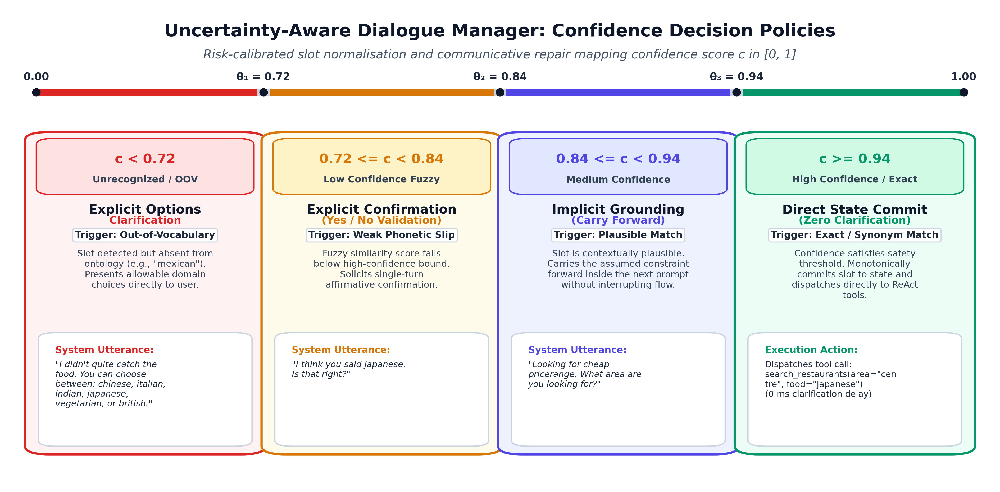
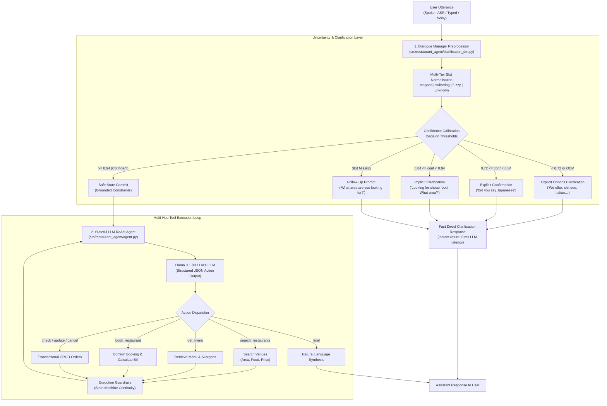

# Uncertainty-Aware Task-Oriented LLM Restaurant Dialogue Agent

[](https://github.com/Ceviche98/llm-restaurant-dialogue-agent/actions/workflows/ci.yml)
[](https://www.python.org/downloads/)
[](https://github.com/Ceviche98/llm-restaurant-dialogue-agent)
[-success.svg)](https://github.com/Ceviche98/llm-restaurant-dialogue-agent)
[](https://github.com/Ceviche98/llm-restaurant-dialogue-agent)
[](LICENSE)

A production-grade, uncertainty-aware task-oriented conversational AI system combining **LLM multi-hop tool execution** with a **statistical Dialogue Manager (DM)** for slot normalisation, confidence thresholding, and risk-calibrated clarification policies.

The system is designed to handle the core vulnerabilities of conversational AI in real-world deployment: acoustic speech recognition noise (ASR errors), user typos, out-of-vocabulary (OOV) requests, and conversational ambiguity, while executing reliable transactional restaurant bookings and dish pre-orders.

---

## 1. Baseline Task-Oriented Agent & Tool Execution Architecture

The foundational conversational system is built around a stateful **ReAct (Reasoning + Acting)** execution loop that coordinates natural language user requests with deterministic backend business operations.

```
User Input ───► LLM Prompt Grounding ───► JSON Tool Call ───► Database Dispatch ───► Guardrail & Response
```

### 1.1 Domain Ontology & Relational Database
The agent operates over structured JSON schemas containing restaurant profiles, menu items, allergen information, and transactional order records:
- **`restaurants.json`**: Profiles indexed by restaurant ID (`r001`-`r005`), name, cuisine (`chinese`, `italian`, `indian`, `japanese`, `vegetarian`, `british`), geographical zone (`centre`, `north`, `south`, `east`, `west`, `riverside`), and price tier (`cheap`, `moderate`, `expensive`).
- **`menus.json`**: Dish catalogues keyed by restaurant ID with dish codes, names, prices, and allergen labels.
- **`orders.json`**: Transactional booking store tracking customer name, date, time, party size, ordered dish IDs, and active lifecycle status (`confirmed`, `cancelled`).

### 1.2 Structured Tool Dispatch API
The LLM communicates with the application environment strictly via structured JSON action blocks:
- `search_restaurants(area, food, pricerange)`: Queries the relational database for matching venues.
- `get_menu(restaurant_id)`: Fetches dishes, descriptions, prices, and allergen metadata.
- `book_restaurant(restaurant_id, day, time, people, customer_name, dishes)`: Validates availability, calculates the total bill, pre-orders dishes, and generates an order ID (`ORD-XXXXXX`).
- `check_order(order_id)`: Queries active booking details and order status.
- `update_order(order_id, dishes)`: Dynamically adds or modifies pre-ordered items and recalculates the bill.
- `cancel_order(order_id)`: Marks a booking as cancelled non-destructively.
- `final(response)`: Synthesizes user-facing natural language responses.

### 1.3 Dynamic Execution Guardrails
To prevent common LLM pitfalls (infinite retrieval loops, hallucinated booking IDs, or premature order confirmation), the agent enforces deterministic state machine constraints:
1. **Search Disambiguation Guardrail:** When candidate venues are returned, the agent is restricted to presenting options to the user before booking.
2. **Zero-Result Recovery Guardrail:** When zero venues match the specified criteria, the agent prompts the user to relax constraints rather than repeating failed queries.
3. **Post-Booking Lock:** Once a booking is created, subsequent search commands are locked to prevent accidental state corruption.
4. **Off-Topic Guidance:** Off-topic inquiries trigger a concise summary of system capabilities.

---

## 2. The Production Challenge: Conversational Uncertainty & ASR Noise

In deployment, especially in **spoken dialogue environments** paired with Automatic Speech Recognition (ASR) engines like Whisper or Vosk, real-world input is rarely clean or canonical:
- **Acoustic Transcription Noise:** Phonetic misspellings and surface variants (e.g., *"lo priced"* instead of *"cheap"*, *"japnese"* instead of *"japanese"*, *"downtown"* instead of *"centre"*).
- **Out-of-Vocabulary (OOV) Requests:** Users requesting items outside the domain ontology (e.g., *"mexican food"*).
- **Ambiguous or Incomplete Specifications:** Users omitting critical booking constraints (date, time, party size).

Passing raw, ungrounded noisy utterances directly into an LLM often causes hallucinated tool arguments, wrong database queries, or silent transaction failures.

---

## 3. Uncertainty-Aware Dialogue Manager & Clarification Policies

To eliminate these failure modes, we introduce a **Dialogue Manager (DM)** preprocessing layer that intercepts user utterances *before* they reach the LLM, scoring slot confidence and executing risk-calibrated communicative actions.

<div align="center">
  
</div>

<br/>

**Figure 1:** Continuous slot grounding spectrum mapping confidence scores $c \in [0, 1]$ across calibrated decision thresholds $(\theta_1 = 0.72, \, \theta_2 = 0.84, \, \theta_3 = 0.94)$ to communicative repair actions.

### 3.1 Multi-Tier Slot Normalisation (`normalize_slot_verbose`)
Every user utterance is parsed against the domain ontology (`area`, `food`, `pricerange`) across a 5-tier classification hierarchy:
1. **Mapped ($1.00$ Confidence):** Exact match with an ontology entry or known synonym dictionary (e.g., *"downtown"* $\to$ `"centre"`).
2. **Substring ($0.95$ Confidence):** An ontology keyword appears as an exact whole-word substring in the text.
3. **Fuzzy Match ($0.72 - 0.94$ Confidence):** Token-level $n$-gram Levenshtein / SequenceMatcher distance against ontology entries (e.g., *"lo priced"* $\to$ `"cheap"`, *"japnese"* $\to$ `"japanese"`).
4. **Unknown ($0.00$ Confidence):** A slot was mentioned by the user (detected via syntactic domain patterns), but does not exist in the ontology (e.g., *"mexican food"*).
5. **Missing ($0.00$ Confidence):** The slot was not referenced in the utterance.

### 3.2 Decision Boundaries & Communicative Actions (`decide_clarification`)
Based on the confidence scores and slot status, the Dialogue Manager triggers the optimal repair action:

| Confidence Range | Condition | Policy Action | Agent Response Strategy |
| :--- | :--- | :--- | :--- |
| **$c < 0.72$** | Out-of-Vocabulary / Unrecognized | `explicit_clarification` (with choices) | Present valid domain choices: *"I didn't quite catch the food. You can choose between: chinese, italian, indian, japanese, vegetarian, or british."* |
| **$0.72 \le c < 0.84$** | Low-Confidence Fuzzy Match | `explicit_clarification` (targeted confirmation) | Seek explicit confirmation: *"I think you said japanese. Is that right?"* |
| **$0.84 \le c < 0.94$** | Medium-Confidence Match | `implicit_clarification` (carry forward) | Embed assumption into the next turn: *"Looking for cheap pricerange. What area are you looking for?"* |
| **Slot Missing** | Unspecified Essential Constraint | `follow_up` (slot filling) | Ask targeted prompt: *"What area are you looking for?"* |
| **$c \ge 0.94$** | High Confidence / Exact Match | Direct State Commit | Pass verified constraints directly to the LLM ReAct loop without interruption. |

### 3.3 Safe State Machine Updates (`update_state_from_parsed`)
The Dialogue Manager guarantees state integrity across multi-turn exchanges:
- Confirmed slot values are **monotonically preserved** and cannot be overwritten by subsequent noisy tokens.
- Low-confidence candidates remain in a pending state until explicitly validated by the user.
- Clarification prompts execute in $0\text{ ms}$ locally without incurring LLM API latency.

---

## 4. Integrated System Architecture

When combined, the system operates as a unified two-layer conversational architecture:



---

## 5. End-to-End Dialogue Walkthroughs

### Dialogue 1: Handling Noisy ASR Input & Food Pre-Ordering
```
User:       "I want some lo priced japnese dining around central please"
DM Action:  Implicit Clarification (Fuzzy match on 'cheap' and 'japanese', mapped 'centre')
Agent:      "Looking for cheap pricerange. We have Sakura Japanese (r003) in the centre. Would you like to book?"

User:       "Yes, book for 2 people on Friday at 20:00 under Oscar, and pre-order 2 Chicken Teriyaki"
LLM Action: {"action": "book_restaurant", "args": {"restaurant_id": "r003", "day": "Friday", "time": "20:00", "people": 2, "customer_name": "Oscar", "dishes": {"j01": 2}}}
Agent:      "Your table at Sakura Japanese is confirmed for Friday at 20:00 for 2 guests under Oscar. Total: £25.00. Your order ID is ORD-466820."
```

### Dialogue 2: Handling Out-of-Vocabulary Requests with Targeted Options
```
User:       "Can you find me a mexican restaurant in riverside?"
DM Action:  Explicit Options Clarification (Detected 'mexican' as OOV food)
Agent:      "I didn't quite catch the food. You can choose between: chinese, italian, indian, japanese, vegetarian, or british."

User:       "Okay, let's do Italian instead"
DM Action:  Direct State Commit ('italian' mapped with confidence 1.0)
LLM Action: {"action": "search_restaurants", "args": {"area": "riverside", "food": "italian"}}
Agent:      "We found Bella Vista (r002) in riverside. Would you like to reserve a table?"
```

### Dialogue 3: Transactional Order Lifecycle (CRUD Order Operations)
```
User:       "Check order ORD-466820"
LLM Action: {"action": "check_order", "args": {"order_id": "ORD-466820"}}
Agent:      "Order ORD-466820 is confirmed for Oscar at Sakura Japanese (Friday 20:00, 2 guests). Dishes: 2x Chicken Teriyaki. Total: £25.00."

User:       "Actually, can you change that to 1 Chicken Teriyaki and 1 Salmon Nigiri?"
LLM Action: {"action": "update_order", "args": {"order_id": "ORD-466820", "dishes": {"j01": 1, "j02": 1}}}
Agent:      "Order ORD-466820 has been updated to 1x Chicken Teriyaki and 1x Salmon Nigiri. New total: £21.50."

User:       "Please cancel the booking"
LLM Action: {"action": "cancel_order", "args": {"order_id": "ORD-466820"}}
Agent:      "Order ORD-466820 has been successfully cancelled."
```

---

## 6. Quantitative Scenario Benchmarks & Verification

The test harness (`scripts/evaluate_scenarios.py`) evaluates the system across standard multi-turn task scenarios in `data/test_scenarios.json`:

| Scenario ID | Dialogue Objective | Turn Count | Key Verification Checks | Benchmark Result |
| :--- | :--- | :---: | :--- | :---: |
| **T1** | Booking with Food Pre-Order & Clean Exit | 6 | Order persistence verified, total price computed, state updated | **100% Pass** |
| **T2** | Off-Topic Guidance & Recovery | 1 | Lists allowable areas/cuisines, redirects user | **100% Pass** |
| **T3** | Full CRUD Order Lifecycle | 11 | Create $\to$ Query $\to$ Update dishes $\to$ Cancel $\to$ Verify cancelled | **100% Pass** |
| **T4** | Nonexistent Order ID Recovery | 1 | Gracefully returns *"Order not found"* error without crashing | **100% Pass** |
| **Total** | **End-to-End Benchmark Suite** | **19** | **All 4 Task Scenarios Verified** | **100.0% PASS** |

---

## 7. Repository Structure

```
llm-restaurant-dialogue-agent/
├── data/
│   ├── menus.json                  # Dishes, prices, and allergen details
│   ├── orders.json                 # Transactional booking records
│   ├── restaurants.json            # Restaurant profiles (area, food, price)
│   └── test_scenarios.json         # Automated evaluation multi-turn scenarios
├── docs/
│   └── assets/                     # Architecture diagrams and decision boundary plots
│       └── dm_clarification_tradeoffs.png
├── scripts/
│   ├── evaluate_scenarios.py       # Automated benchmark evaluation harness
│   └── run_agent_cli.py            # Interactive terminal CLI chat
├── src/
│   └── restaurant_agent/
│       ├── __init__.py
│       ├── agent.py                # Stateful ReAct dialogue agent & LLM interface
│       ├── clarification_dm.py     # Slot normalisation & clarification policy
│       ├── database.py             # Relational data layer & CRUD order management
│       ├── evaluator.py            # Scenario simulation runner & rule-based mock LLM
│       └── tools.py                # Tool dispatch handler & JSON schema validator
├── tests/
│   └── test_restaurant_agent.py    # Automated unit & integration tests
├── .gitignore
├── LICENSE                         # MIT License
├── pyproject.toml
└── requirements.txt
```

---

## 8. Quickstart & Usage

### 1. Installation
```bash
git clone https://github.com/Ceviche98/llm-restaurant-dialogue-agent.git
cd llm-restaurant-dialogue-agent
pip install -r requirements.txt
pip install -e .
```

### 2. Run the Automated Scenario Benchmark
```bash
python scripts/evaluate_scenarios.py
```
Output:
```text
========================================================================
SCENARIO EVALUATION SUMMARY: 4/4 Passed (100.0%)
========================================================================
[PASS] t1_booking_with_food_preorder (6 turns)
[PASS] t2_offtopic_guidance (1 turns)
[PASS] t3_query_update_cancel (11 turns)
[PASS] t4_nonexistent_order_id (1 turns)
```

### 3. Run the Test Suite
```bash
pytest tests/ -v
```

### 4. Interactive Terminal Chat CLI
```bash
python scripts/run_agent_cli.py
```
*(Optional: Provide `--model` and `--ollama-url` to connect to a running local Ollama instance with Llama 3.1 8B)*.

---

## License

This project is licensed under the MIT License: see the [LICENSE](LICENSE) file for details.
